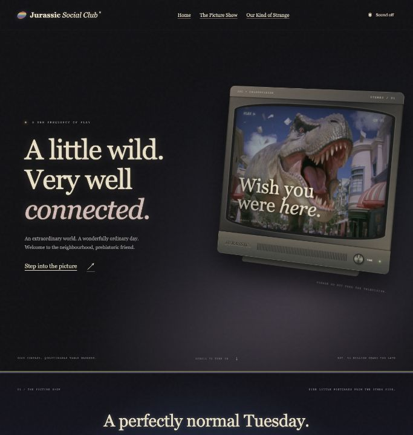
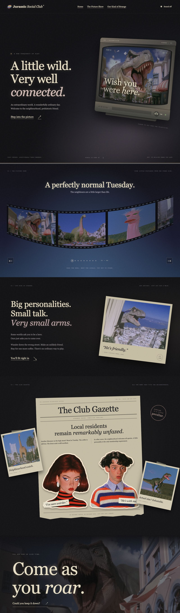

<div align="center">

# Jurassic Social Club

### A little wild. Very well connected.

A cinematic corner of the internet where prehistoric creatures become the neighbours.

**[Enter the neighbourhood ↗](https://xwen111.github.io/jurassic-social-club/)** · [Explore the full page](docs/full-page.jpg) · [Design notes](#art-direction)



*Good company. Questionable table manners.*

</div>

## Welcome to the other side

Jurassic Social Club is an art-directed, interactive website for a fictional dinosaur game. It began as a website-within-a-film: a character creates a launch page for a world in which people walk dinosaurs down pastel streets and nobody seems particularly surprised.

This project brings that world into the browser. The emphasis is atmosphere, image-making and playful discovery: a little vintage cinema, a little neighbourhood newspaper, and a very large personality at the café next door.

It is a visual concept and launch-page experience, not a playable game or an announced commercial release.

## Meet the neighbourhood

The cast moves between cinematic creatures and deliberately toy-like oddities. A towering long-neck takes the scenic route. A pink, spiky character brings impeccable attitude. A winged commuter squeezes between skyscrapers. A tiny green tyrannosaur makes an unnecessarily dramatic entrance.

These are imaginative characters, not scientific reconstructions. Their shared language is tactile texture, film grain, unexpected colour and an entirely straight-faced sense of humour.

> “Another dinosaur on the high street? Must be Tuesday.”

## Art direction

| Element | Direction |
| --- | --- |
| Palette | Charcoal, midnight indigo, warm ivory and dusty rose |
| Typography | Generous Georgia serif headlines, italic accents and typewriter-like microcopy |
| Image language | Pastel streets, practical-effects nostalgia, toy creatures and grainy cinematic portraits |
| Surface | Subtle scanlines, paper edges, soft phosphor-like glow and restrained noise |
| Composition | Large editorial type, a dimensional television, curved film and an off-centre newspaper collage |
| Tone | Surreal, social and quietly funny |

The design borrows the feeling of analogue objects without turning the whole interface into an imitation operating system. Images carry the story; movement gives them a little life.

## Take a look around

- **Colourvision:** turn the television dial to browse nine dinosaur channels.
- **The Picture Show:** drag the curved film reel, use its arrows or select one of nine scenes.
- **Our Kind of Strange:** a photographic postcard from a particularly curious neighbour.
- **The Club Gazette:** white-bordered portrait stickers, taped snapshots and a fictional neighbourhood newspaper.
- **Come as you roar:** a small callback to the film's “Could you keep it down?” joke.
- **Sound, if you want it:** optional synthesized ambient tones; audio starts only after a click.

The layout adapts to smaller screens, controls support keyboard focus, and motion respects the browser's reduced-motion preference.

## The full picture

[](https://xwen111.github.io/jurassic-social-club/)

## Built for the browser

Plain HTML, CSS and JavaScript. No framework, package installation, account, backend or build step is required.

The curved reel uses Canvas 2D: narrow image strips are drawn along a changing curve to create a continuous film-like surface. The television and paper collage are composed with CSS. Optional audio uses the Web Audio API.

```text
index.html       Page content and structure
style.css        Art direction, layout and responsive styling
app.js           Film reel, channel dial and small interactions
assets/          Dinosaur scenes and portrait sticker artwork
docs/            Cover and full-page screenshots
LICENSE          MIT license for source code
ASSETS.md        Visual asset credits and reuse scope
```

### Run locally

```bash
git clone https://github.com/xwen111/jurassic-social-club.git
cd jurassic-social-club
python3 -m http.server 8000
```

Open **http://localhost:8000**. You can also open `index.html` directly for a quick local preview.

### Publish with GitHub Pages

The live website is served from the `main` branch, repository root. In **Settings → Pages**, select **Deploy from a branch**, **main**, and **/ (root)**. The `.nojekyll` file keeps this a plain static website.

## Credits & license

Concept, visual curation and creative direction by **[xwen111](https://github.com/xwen111)**. Website implementation and selected image treatments were developed with AI assistance. The imagery combines creator-supplied visuals and AI-generated or AI-edited artwork.

The source code is released under the **[MIT License](LICENSE)**. Visual assets, portraits, artwork and screenshots are excluded from the MIT grant; see **[ASSETS.md](ASSETS.md)** before reusing them. You are welcome to study and adapt the code with your own imagery.

---

<div align="center">

**No ordinary people. No ordinary pets. Just very good company.**

[Visit Jurassic Social Club ↗](https://xwen111.github.io/jurassic-social-club/)

</div>
